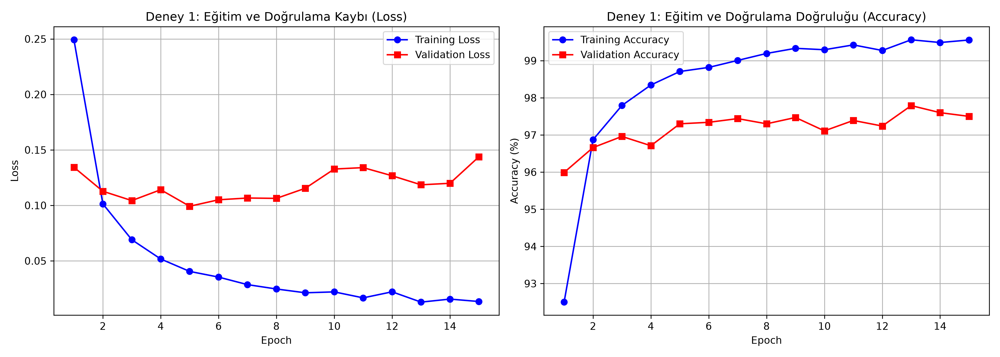
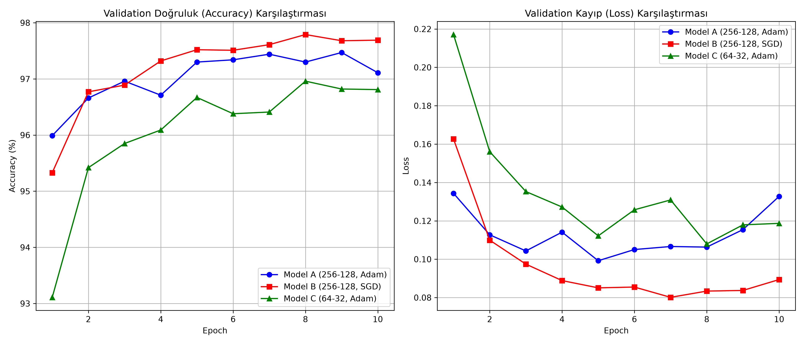
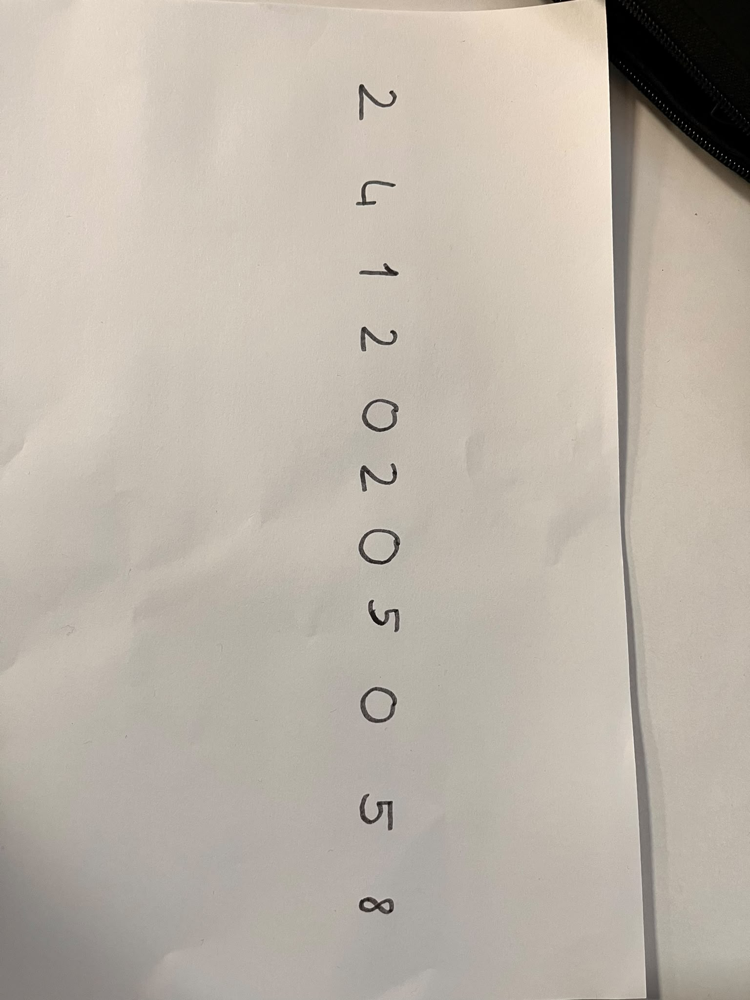
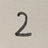

# Derin Öğrenme Ödevi: MNIST ve MLP ile El Yazısı Rakam Tanıma

Bu ödevde, MNIST el yazısı veri setini kullanarak sıfırdan bir Çok Katmanlı Algılayıcı (MLP) modeli geliştirdim, eğittim ve farklı parametrelerin model üzerindeki etkilerini karşılaştırdım. Son aşamada ise eğittiğim modeli kendi el yazımla test ederek başarısını ölçtüm.

Ödev kuralları gereği CNN veya hazır eğitilmiş bir model kullanmadım; mimariyi tamamen `nn.Linear` katmanları ile sıfırdan oluşturdum.

## 1. Veri Setinin Hazırlanması
Modelin verileri ezberlemesini önlemek için MNIST veri setini Train, Validation ve Test olmak üzere üçe böldüm (50.000 eğitim, 10.000 doğrulama ve 10.000 test). Ödev kurallarında belirtildiği gibi test verisini eğitim sürecine hiç dahil etmedim, sadece modelin nihai başarısını ölçmek için en sonda 1 kez kullandım. 

Modeli beslemeden önce pikselleri normalize ettim ve MLP mimarisi resimleri tek boyutlu bir liste olarak istediği için `nn.Flatten()` kullanarak 28x28 boyutundaki görüntüleri 784 elemanlı vektörlere dönüştürdüm.

---

## 2. Deney 1: Temel MLP Modeli ve Sonuçları
İlk deneyde ödev şartlarını sağlamak için en az iki gizli katman içeren temel bir mimari kurdum. 
* **Mimari:** Girdi(784) -> Gizli(256) -> Gizli(128) -> Çıktı(10)
* **Kullanılan Hiperparametreler:** Aktivasyon: ReLU, Kayıp Fonksiyonu: CrossEntropyLoss, Optimizer: Adam (lr=0.001), Batch Size: 64, Epoch: 15.

**Raporlanması İstenen Sonuçlar (15. Epoch ve Nihai Test):**
* **Training loss:** 0.0134
* **Validation loss:** 0.1438
* **Training accuracy:** %99.56
* **Validation accuracy:** %97.50
* **Test accuracy:** %97.89
* **Eğitim süresi:** 196.72 saniye

**Deney 1 Gözlemlerim:**
Aşağıdaki loss ve accuracy grafiklerini incelediğimde, ilk 6 epoch boyunca modelin gayet güzel öğrendiğini fark ettim. Ancak 6. epoch'tan sonra eğitim kaybı (Training Loss) sıfıra doğru inmeye devam ederken, doğrulama kaybı (Validation Loss) yavaşça artmaya başladı. Bu durum modelin eğitim verisini ezberlemeye (overfitting) başladığını net bir şekilde gösteriyor.

---

## 3. Deney 2: Hiperparametre ve Yapılandırma Karşılaştırması
Farklı hiperparametrelerin model performansına etkisini analiz etmek için 3 farklı modeli 10 epoch boyunca aynı anda eğitip yarıştırdım:
* **Model A (Mavi Çizgi):** Deney 1'deki en iyi modelimiz (256-128 katman ve Adam optimizer).
* **Model B (Kırmızı Çizgi):** Model A'nın SGD (lr=0.01) optimizer kullanılan versiyonu.
* **Model C (Yeşil Çizgi):** Nöron sayıları azaltılmış (64-32 katman) ve Adam kullanan daha dar bir model.

**Deney 2 Gözlemlerim:**
* Nöron sayısını düşürdüğüm Model C, doğruluk oranında hep en geride kaldı. Demek ki karmaşık el yazılarını öğrenmek için az nöronlu modelin kapasitesi yetersiz kaldı.
* Adam kullanan Model A başlarda çok hızlı öğrenmesine rağmen sonlara doğru hata grafiğinde yukarı doğru kırılmalar yaptı (ezberlemeye kaydı). Klasik SGD kullanan Model B ise başlarda yavaş öğrense de çok daha istikrarlı ilerledi ve en düşük hata oranına ulaştı.

---

## 4. Kendi El Yazım ile Test ve Dağılım Kayması (Distribution Shift)
Ödevin son aşamasında modeli kendi el yazımla test etmek için boş beyaz bir kağıda öğrenci numaramın rakamlarını (24120205058) siyah kalemle yazdım ve fotoğraflarını çekip bilgisayara aktardım.

Resimleri modele vermeden önce MNIST formatına uygun hale getirdim:
1. Resimleri `convert('L')` ile gri tonlamaya çevirdim.
2. Beyaz kağıt üzerindeki siyah yazıları MNIST ile aynı formata getirmek için renkleri `ImageOps.invert()` ile tersine çevirdim (siyah arka plan, beyaz yazı).
3. Resimleri 28x28 boyutuna küçültüp piksel değerlerini eğitimdeki standart sapma ile normalize ettim.

**Dağılım Kayması (Distribution Shift) Değerlendirmem:**
Model test verisinde %97.89 başarı göstermesine rağmen, kendi kağıda yazdığım rakamlarda bazı hatalar yaptı (örneğin 8'i 5, 0'ı 7 olarak tahmin etti). Bunun temel sebebinin eğitim verisi ile gerçek dünya verisi arasındaki "dağılım kayması" (distribution shift) olduğunu gözlemledim. MNIST veri setindeki rakamlar merkeze düzgünce oturtulmuş, pürüzsüz ve standart karakterlerden oluşuyor. Benim telefondan çektiğim resimlerdeki ışık yansımaları, kağıdın dokusu (noise), kalem kalınlığı ve benim kişisel yazı karakteristiğim modelin alıştığı veriden farklı olduğu için, model ezberlediği matris özelliklerini bulamadı ve genelleme yapmakta zorlandı.

*(Not: Kendi verilerimle yaptığım görüntü işleme ve test adımları projedeki `Tahmin.py` dosyasında yer almaktadır.)*

## Sonuç
Bu ödev sayesinde; veriyi doğru şekilde bölmenin modelin ezberlemesini fark etmedeki önemini, loss/accuracy grafiklerini yorumlamayı, katman kapasitesi veya optimizer değiştirmenin performansı nasıl doğrudan etkilediğini analiz ettim. Ayrıca eğitim verisiyle canlı dünya verisi (distribution shift) arasındaki farkın model performansını nasıl etkileyebileceğini kendi numaramı test ederek bizzat tecrübe ettim.